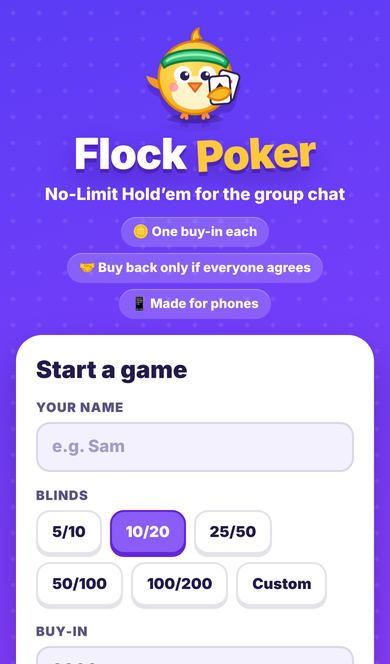
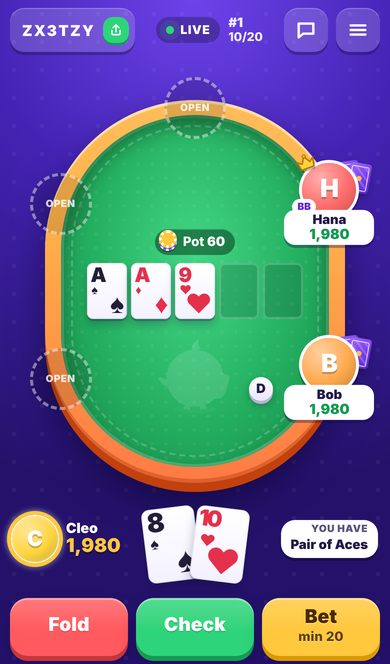
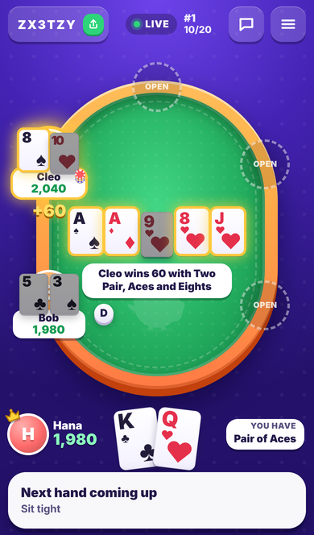
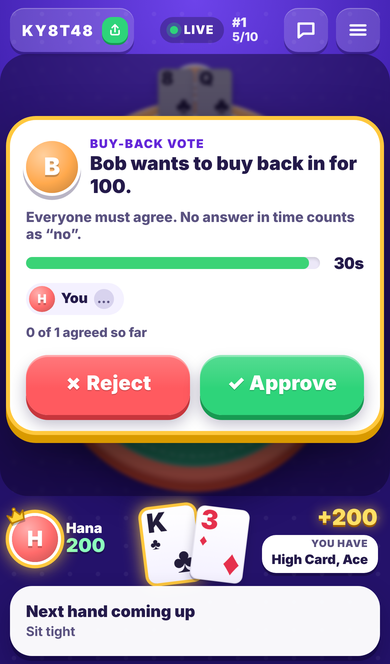
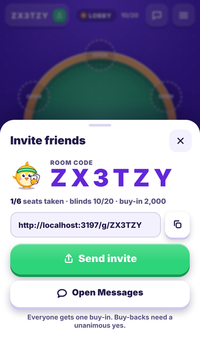
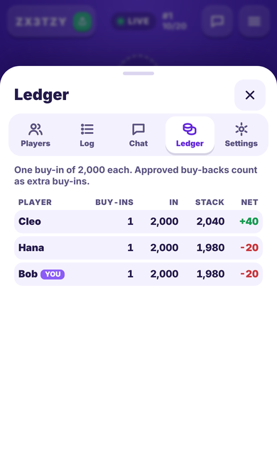

# Flock Poker

**No-Limit Texas Hold'em for the group chat.** Start a table, drop the link in your group chat and
your friends tap it to pull up a chair. No sign-up and no app to install, and it is built for phones first.
It's a casual party game with the tools of a proper home-game room: host controls, seat approval,
a shot clock, a hand log, a chip ledger and table chat.

Play money only.

<p align="center">
  
  
  
</p>
<p align="center">
  
  
  
</p>

---

## House rules

These are enforced by the server, not just the UI.

1. **One buy-in.** Everyone who sits down gets exactly the table's buy-in, once. There are no
   top-ups and no free rebuys. Standing up or leaving keeps your stack: when you sit down again you
   come back with the same chips (or with nothing, if you were busted).
2. **Buying back in needs a unanimous yes.** A seated player with 0 chips can ask to buy back in
   for the same amount as the buy-in. Every *other* seated player votes:
   - one **No** rejects the request immediately,
   - when **everyone** says Yes it is approved immediately, and the stack is restored,
   - each voter gets the table's vote timer (15–120 s). **Anyone who hasn't answered when the timer
     runs out counts as a No**, and the request is rejected as *timed out*.

   After a rejection the player must wait 30 seconds before asking again. The host can turn
   buy-backs off completely, which also cancels any request still being voted on.
3. **Table capacity.** A table has 2–10 seats. People can join until every seat is taken; after
   that newcomers can watch as spectators and sit as soon as a seat opens.

The ledger always shows each player's buy-ins, current chips and net result, and the chips on the
table always add up to the total bought in.

## Features

- **Link-based rooms.** A 6-character room code (no look-alike characters) and a `/g/CODE` link with a
  rich preview card for iMessage, WhatsApp, Slack and others.
- **The full No-Limit Hold'em engine.** Blinds (heads-up rules included), min-raise and
  re-opening rules, all-in side pots, uncalled bets returned, odd chips, all-in runouts with
  the cards face up, and showdown hand names ("Full House, Kings full of Twos").
- **Host controls.** Start, pause and resume, edit the blinds, seats, shot clock, vote timer
  and approval setting, approve or deny seat requests, kick players, hand the host role to
  someone else, and start a rematch with a fresh single buy-in for everyone. If the host's phone
  stays disconnected for 90 seconds while others are playing, the host role passes to the next
  connected player, so approvals never get stuck.
- **Shot clock** (optional): a player who runs out of time checks or folds automatically. After two
  timeouts in a row they are sat out. Without a shot clock, a disconnected player still auto-acts
  after 30 seconds so the table never freezes.
- **Mobile table.** One-tap Fold / Check / Call / Raise, a raise slider with ½ pot, ¾ pot, pot and
  all-in presets, and act-in-advance toggles (Check/Fold, Call, Call any). A "You have…" hint
  describes your hand. You also get haptics, sounds and a flashing tab title when it's your turn,
  plus a four-colour deck option.
- **Chat** with quick replies, a **hand-by-hand log**, a **ledger**, **spectators**, **reconnects**
  (reloading or re-opening the link brings you back to the same seat, stack and cards), and
  an installable PWA.
- **Private cards.** Every phone gets its own view of the table. Nobody else's face-down cards are
  ever sent to your device, only cards that are turned face up (a showdown, an all-in runout, or
  cards someone chooses to show).

## Playing from a group chat

1. Open the site, enter your name, pick blinds, the buy-in, the number of seats and the timers,
   then tap **Create table**.
2. Tap **Send invite** to share the link to your group chat. You can also copy it, or read out the
   room code.
3. Friends tap the link, type a name and tap an open seat. If you turned on *Approve players
   before they sit*, you'll get an **Approve / Deny** card for each request.
4. When at least two people are seated, tap **Start game**. New hands deal themselves.
5. Busted? Tap **Ask to buy back in**, and everyone else at the table gets a vote with a countdown.

**Tip: Add to Home Screen.** On iPhone, open the site in Safari, tap **Share**, then **Add to Home
Screen**. On Android, open the site in Chrome and choose **Add to Home screen** from the ⋮ menu.
Flock Poker then opens full screen like an app. iOS keeps separate storage for home-screen
apps, so join a table from the app itself (enter the room code on its home page), or keep playing
in the browser tab where you joined.

## Local development

You need Node 22 or newer (20 also works).

```bash
npm install
npm run dev
```

- The client (Vite, with hot reload) runs on **http://localhost:5173**.
- The API and Socket.IO server (`tsx watch`) runs on **:3001**. Vite proxies `/api` and `/socket.io` to it.

### Playing on phones over the same Wi-Fi

The Vite dev server listens on every network interface (`server.host: true`). When it starts, it
prints a `Network:` URL like `http://192.168.1.23:5173`. Open that URL on each phone connected
to the same Wi-Fi and play. If phones can't connect, allow port 5173 through your computer's
firewall. To test a production build on your network, run `npm run build && npm start` and open
`http://<your-computer-ip>:3001`.

## Production

```bash
npm run build      # client -> dist/client, server -> dist/server/index.js
npm start          # node dist/server/index.js
```

| Env var      | Default          | Purpose                                                                  |
| ------------ | ---------------- | ------------------------------------------------------------------------ |
| `PORT`       | `3001`           | HTTP and websocket port                                                  |
| `HOST`       | all interfaces   | Interface to bind to                                                     |
| `PUBLIC_URL` | the request host | Absolute origin for link-preview images, e.g. `https://poker.example.com` |

A single Node process serves the built client, the JSON API (`GET /api/health` and
`GET /api/rooms/:code`) and the websockets.

## Deploying

The app is a single Node web service that needs websockets. Both files below are included in the repo.

- **Render**: the `render.yaml` blueprint describes one Node web service. It runs `npm ci --include=dev && npm run build`,
  then `npm start`, with a health check on `/api/health`. In the Render dashboard choose **New → Blueprint**
  and pick this repository.
- **Docker**: the `Dockerfile` is a multi-stage Node 22 Alpine image that listens on port 3000:

  ```bash
  docker build -t flock-poker .
  docker run -p 3000:3000 flock-poker
  ```

  It runs on any container host (Fly.io, Railway, Cloud Run, a VPS…) as long as it supports websockets.

> **Rooms live in memory.** Run exactly **one** instance. A restart or redeploy ends every game in
> progress, and players will see "Game not found". A room is deleted once nobody has been
> connected to it for 6 hours.

## Testing

```bash
npx tsc --noEmit -p tsconfig.json   # typecheck (strict)
npx vitest run                      # unit tests: engine, evaluator, rooms, sockets, HTTP, client logic
npm run build                       # production build
npm run e2e                         # Playwright end-to-end tests
```

`npm run e2e` builds the app, starts the production server on port 3100, and drives several
iPhone-sized Chromium "phones". Each one is a separate browser context, so it acts like a different
friend's device. The tests cover:

- the happy path: create from the home screen, invite, join, sit, deal, check it down to showdown,
  confirm no hole cards leak in the websocket frames, ledger totals, and chat;
- a buy-back that is approved, one that is rejected (with the cooldown), and one that times out
  (silence counts as no);
- a full table, where the third phone can only watch;
- reconnecting after a reload: same seat, stack and cards;
- host approval for seat requests.

Screenshots of key moments are saved to `e2e/screenshots/e2e-*.png`. Set `E2E_PORT` to use another
port. Chromium must already be installed for Playwright (`npx playwright install chromium`).
GitHub Actions (`.github/workflows/ci.yml`) runs all four steps on every push and pull request.

For visual QA, `?mock=<scenario>` (for example `/?mock=showdown-split`) renders fixture states without a
server. `node scripts/mock-screenshots.mjs <baseUrl>` captures every scenario at phone, landscape
and desktop sizes.

## Project structure

```
src/
  shared/            contract used by both sides
    types.ts         RoomView, HandView, GameSettings, ledger, votes…
    protocol.ts      Socket.IO events (client → server with acks, server → client)
    constants.ts     limits, defaults, timings
    cards.ts         card primitives
    evaluator.ts     7-card hand evaluator (also used for the client's "You have…" hint)
  server/
    index.ts         entry: reads PORT/HOST/PUBLIC_URL, graceful shutdown
    app.ts           Express app, static client, /api, link-preview meta for /g/:code
    socket.ts        Socket.IO handlers: zod validation, rate limits, per-player state broadcasts
    engine/          pure No-Limit Hold'em engine (one hand at a time) + side pots + deck
    room/            Room (seats, hands, shot clock, buy-back votes, chat, log, ledger) and RoomManager
  client/            React 19 + zustand, mobile-first
    net/             socket wrapper, join/rejoin flow, actions
    state/           zustand store
    screens/         home, join, not-found / kicked / error screens
    table/           table, seats, board, hero strip, action bar, buy-back voting
    sheets/          invite sheet, menu (players, log, chat, ledger, settings)
    lib/             pure helpers (seat layout, raise sizing, pre-actions, descriptions) + tests
    mock/            ?mock= fixtures for visual QA (lazy-loaded)
public/              icons, manifest, link-preview image
e2e/                 Playwright tests (+ screenshots, not committed)
docs/screenshots/    images used in this README
scripts/             dev runner, server bundler, icon renderer, mock screenshots
```

## Known limitations

- There are no accounts. A phone's identity at a table is a token stored in that browser. Someone could join
  again from another browser (or a private tab) as a "new" player with a fresh buy-in. Hosts can turn
  on *Approve players before they sit* and kick anyone who does that.
- Game state is in memory, as described in Deploying above.
